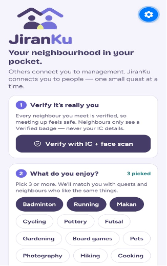
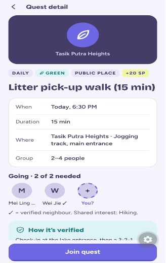
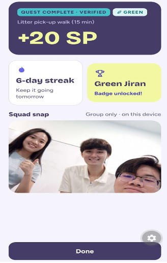
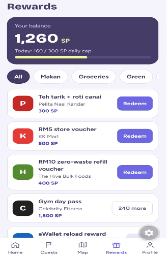
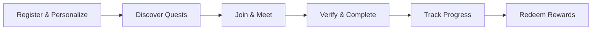

# 🏘️ JiranKu

> *Neighbours meet through small real-world quests.*

A gamified community app that transforms local interactions into rewarding experiences through daily quests, neighbourhood challenges, and a points-based reward system.

---

## 🌟 The Problem

Urban living often leads to social isolation despite physical proximity. Neighbours may live meters apart yet never interact, missing opportunities for friendship, community support, and shared experiences. Traditional neighbourhood initiatives struggle with engagement and fail to create lasting connections.

---

## 💡 The Solution

JiranKu brings neighbours together through micro-quests that encourage real-world interactions. In today's digital-first world, many people living in the same neighbourhoods rarely connect with each other. JiranKu bridges this gap by turning simple activities into rewarding social experiences.

### Core Features

| Feature | Description |
|---------|-------------|
| 🎯 **Daily Quests** | Small, achievable activities like high-fiving a neighbour, joining a group walk, or playing badminton |
| 🏆 **Neighbourhood Raids** | Monthly collaborative challenges that bring the entire community together toward a common goal |
| 🌱 **Sustainability Focus** | Green quests that promote environmental stewardship through activities like litter walks and tree planting |
| 🎁 **Rewards System** | Earn JiranPoints (JP) for completing quests and redeem them for real value from local businesses |
| 🔥 **Streak & Progress** | Build engagement through daily streaks, level progression, and badge collection |

---

## 📸 App Screenshots

### Registration & Onboarding


### Join a Quest


### Verify with Group Photo


### Redeem Rewards


---

## 🔄 How It Works



1. **📝 Register & Personalize** — Users select their interests, age group, and neighbourhood during onboarding
2. **🔍 Discover Quests** — Browse daily quests tailored to their interests and neighbourhood
3. **🤝 Join & Meet** — Sign up for quests, check in at the location, and meet neighbours in person
4. **📸 Verify & Complete** — Take a group photo to verify participation and earn JiranPoints
5. **📊 Track Progress** — Monitor streaks, levels, and badges as you build your community profile
6. **🎁 Redeem Rewards** — Exchange earned points for vouchers and discounts from local partners

---

## 🌍 Impact Potential

JiranKu has the potential to transform communities:

- **🤝 Strengthen Communities** — Create genuine connections between neighbours who might otherwise never meet
- **🏃 Promote Physical Activity** — Encourage outdoor activities and exercise through quest-based incentives
- **🏪 Support Local Economy** — Drive foot traffic to local businesses through the rewards partnership program
- **♻️ Foster Sustainability** — Motivate environmental action through green quests and community challenges
- **💬 Reduce Social Isolation** — Provide structured, low-pressure ways for people to socialize
- **🛡️ Build Trust** — Regular positive interactions create safer, more cohesive neighbourhoods

---

## ✨ Key Features

### 🎯 Daily Quests
Fresh quests every day across categories like social activities, fitness, food, and sustainability. Complete all three daily quests to unlock bonus rewards.

### 🏆 Neighbourhood Raids
Monthly community-wide challenges where the entire neighbourhood works together toward a shared goal, fostering collective achievement and neighbourhood pride.

### 🌱 Green Quests
Sustainability-focused activities that promote environmental awareness and action. Completing green quests unlocks special badges and contributes to community environmental goals.

### 🎁 Rewards System
Earn JiranPoints for every completed quest and redeem them for real value from local business partners including restaurants, grocery stores, fitness centers, and e-wallet top-ups.

### 🔥 Streak & Gamification
Maintain daily streaks to maximize point earnings, level up through consistent participation, and collect badges that showcase your community contributions.

### ⚡ Real-time Availability
See which neighbours are currently available and ready to join quests, making it easy to find activity partners on short notice.

### 📊 Leaderboard
Track neighbourhood rankings and see how your community compares to others, adding friendly competition to community building.

---

## 🛠️ Tech Stack

| Category | Technology |
|----------|-----------|
| **Framework** | Expo SDK 57 |
| **Navigation** | Expo Router (file-based routing) |
| **UI Framework** | React Native 0.86.3 |
| **Language** | TypeScript |
| **State Management** | Zustand with AsyncStorage persistence |
| **Animations** | React Native Reanimated 4.5.1 |
| **Fonts** | Bricolage Grotesque (headings), Figtree (body) |
| **Camera** | expo-camera for quest verification photos |
| **Platform Support** | iOS, Android, Web |

---

## 🚀 Run Program

### Prerequisites

- ✅ Node.js (v18 or higher)
- ✅ npm or yarn
- ✅ Expo Go app on your mobile device (for development)
- ✅ Expo account (for building APK/IPA)

### Installation

```bash
npm install
```

### Running the App

#### 📱 Option 1: Expo Go (Recommended)

```bash
npx expo start              # Scan QR code with Expo Go
npx expo start --tunnel     # If network blocks LAN
npx expo start -c           # Clear bundler cache
```

**Steps:**
1. Scan the QR code with the Expo Go app on your phone
2. Ensure your phone and computer are on the same Wi-Fi network
3. The app will load and reload as you make changes

#### 🍎 Option 2: iOS Simulator

```bash
npx expo run:ios
```

#### 🤖 Option 3: Android Emulator

```bash
npx expo run:android
```

#### 🌐 Option 4: Web Browser

```bash
npx expo start --web
```

### Building Standalone Apps

#### 📦 Android APK (EAS Build)

```bash
# Install EAS CLI (first time only)
npm install -g eas-cli

# Login to your Expo account
npx eas-cli@latest login

# Configure the project (first time only)
npx eas-cli@latest build:configure

# Build Android APK (preview profile)
npx eas-cli@latest build -p android --profile preview
```

> Open the build link on your phone, download the `.apk` and install it (you may need to allow "install unknown apps" in your settings).

#### 🏭 Production Build

```bash
npx eas-cli@latest build -p android --profile production
npx eas-cli@latest build -p ios --profile production
```

---

## 📄 License

This project is a demo/hackathon submission. Contact the maintainers for licensing information.

---

<div align="center">

**Built with ❤️ for stronger communities**

</div>
